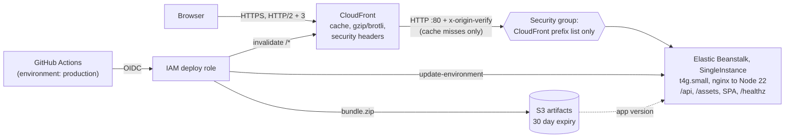

# Infrastructure runbook

VotoBrasil is one Node.js process (Fastify API + static SPA + processed datasets, no database) on a
single AWS Elastic Beanstalk instance, **always behind CloudFront**. Infrastructure is Terraform
(`infra/terraform`); deployments are GitHub Actions using AWS OIDC (no static AWS keys).

## Architecture



Defence for the origin, in order: security group (only CloudFront's origin-facing IPs on port 80),
then the API rejects everything except `GET /healthz` unless `x-origin-verify` matches
`ORIGIN_VERIFY_SECRET`.

### Caching

| Path pattern    | Cache policy       | TTL                                                              |
| --------------- | ------------------ | ---------------------------------------------------------------- |
| `/assets/*`     | `assets`           | origin `immutable` (1 year); 1 day if the origin sends nothing   |
| `/api/*`        | `api`              | origin `s-maxage`/`max-age`; 60 s fallback; query strings keyed  |
| `/healthz`      | CachingDisabled    | never cached (smoke tests hit the real origin)                   |
| everything else | `web` (index.html) | origin `no-cache` honoured; 1 h fallback; no query strings keyed |

Min TTL is 0 everywhere, so the origin's `Cache-Control` always wins; stale entries revalidate with
`ETag`. No cookies or viewer headers are forwarded, so the cache key is just path (+ query for the
API) and `Accept-Encoding`. Every deploy invalidates `/*` (one path, inside the free allowance).
Unknown SPA routes are served as `index.html` by the origin: a CloudFront custom error response is
distribution-wide and would also rewrite API 404s.

## Cost (us-east-1, on demand, approximate)

| Item                                          | USD / month     |
| --------------------------------------------- | --------------- |
| EC2 `t4g.small` (2 vCPU, 2 GB), 730 h         | 12.3            |
| EBS gp3 20 GB                                 | 1.6             |
| Public IPv4 of the instance                   | 3.7             |
| CloudWatch Logs (7-day retention), 1 alarm    | ~0.5            |
| S3 bundles, SNS, Budgets (2 free), IAM, OIDC  | ~0              |
| CloudFront (1 TB + 10 M requests always free) | 0 at this scale |
| Elastic Beanstalk itself                      | 0               |
| **Total**                                     | **about 18**    |

Why each decision:

- **Single instance, no load balancer**: an ALB is ~16 USD/month plus LCUs and a second AZ would
  double compute. The trade-off is no high availability and a short blip on deploys and instance
  replacement; CloudFront keeps serving cached assets and API responses meanwhile.
- **Default VPC, public subnet, no NAT gateway**: a NAT gateway alone costs ~32 USD/month. The
  instance has no inbound exposure except CloudFront (security group) and no SSH (use SSM Session
  Manager).
- **CloudFront in front**: the long-lived datasets are cacheable, so almost every request is served
  from the edge; the 1 TB/month and 10 M requests free tiers cover this site's expected traffic.
  Data transfer from EC2 to CloudFront is free.
- **arm64 (Graviton) `t4g`**: ~20% cheaper than `t3.small` for the same size. The bundle is pure
  JavaScript (esbuild, all dependencies inlined), so it runs unchanged on arm64. If memory allows,
  `t4g.micro` (1 GB) halves the compute line to ~6 USD; check `free -m` under load first.
- **`us-east-1`**: cheapest region. `sa-east-1` cuts origin latency for Brazil but costs roughly
  40-60% more on EC2/EBS; with CloudFront caching, origin latency matters little.
- **`PriceClass_All`**: South America edge locations are only included in `PriceClass_All`;
  `PriceClass_100` would serve Brazilian users from the US, adding ~100-150 ms to every cache hit.
  It is a variable (`cloudfront_price_class`) if the audience changes.
- **Log retention 7 days, no access logs, no WAF**: each adds a recurring cost (WAF starts at ~5 USD
  plus per-rule and per-request fees). See "Known limits".

Prices drift; check the AWS Pricing Calculator before committing to a budget
(`monthly_budget_usd` defaults to 25).

### Why not S3 + CloudFront only?

For purely static JSON it would cost about 1 USD/month and have no server to patch. We use
Elastic Beanstalk because the API computes responses on demand (query parameters, validation,
`ETag`/`Cache-Control` per endpoint, SPA fallback, one process that is identical in local Docker
and production) and the project requirement is to run on Elastic Beanstalk. If every endpoint
eventually becomes a pre-rendered file produced by the ETL, the S3 route becomes the cheaper option
and CloudFront, the cache policies and the deploy role carry over unchanged.

## Bootstrap (one time)

Prerequisites: AWS credentials with admin-like rights for the first `apply` (local only, never
stored in GitHub), Terraform >= 1.6 (CI uses the latest 1.x), AWS CLI, a default VPC in the chosen
region, and a GitHub repository with an environment named `production`.

1. **State bucket** (private, versioned, encrypted; choose a globally unique name):

   ```bash
   export AWS_REGION=us-east-1
   export STATE_BUCKET=<globally-unique-bucket-name>
   aws s3api create-bucket --bucket "$STATE_BUCKET" --region "$AWS_REGION"
   # outside us-east-1 add: --create-bucket-configuration LocationConstraint="$AWS_REGION"
   aws s3api put-public-access-block --bucket "$STATE_BUCKET" \
     --public-access-block-configuration BlockPublicAcls=true,IgnorePublicAcls=true,BlockPublicPolicy=true,RestrictPublicBuckets=true
   aws s3api put-bucket-versioning --bucket "$STATE_BUCKET" --versioning-configuration Status=Enabled
   aws s3api put-bucket-encryption --bucket "$STATE_BUCKET" \
     --server-side-encryption-configuration '{"Rules":[{"ApplyServerSideEncryptionByDefault":{"SSEAlgorithm":"AES256"}}]}'
   ```

2. **Variables**: `cp infra/terraform/terraform.tfvars.example infra/terraform/terraform.tfvars`
   (git-ignored) and set at least `github_repository` (`owner/repo`). Optional: `alarm_email`,
   `domain_name` + `acm_certificate_arn` (certificate issued in **us-east-1**),
   `create_github_oidc_provider = false` if the account already has the GitHub OIDC provider.

3. **Apply**:

   ```bash
   cd infra/terraform
   terraform init \
     -backend-config="bucket=$STATE_BUCKET" \
     -backend-config="key=votobr/prod/terraform.tfstate" \
     -backend-config="region=$AWS_REGION" \
     -backend-config="encrypt=true" \
     -backend-config="use_lockfile=true"   # Terraform >= 1.11; older versions: dynamodb_table=<lock-table>
   terraform apply
   ```

   Expect 15-25 minutes (Elastic Beanstalk and CloudFront). Confirm the SNS subscription email if
   `alarm_email` is set. Until the first deploy the origin serves the platform's sample app.

4. **GitHub**: Settings, Environments, `production`: restrict **Deployment branches** to `main`
   (this is what pins who can assume the role, because the OIDC subject contains the environment,
   not the branch) and optionally add required reviewers. Then set:

   | Where                      | Kind     | Name                         | Value (from `terraform output`)                |
   | -------------------------- | -------- | ---------------------------- | ---------------------------------------------- |
   | Environment `production`   | secret   | `AWS_ROLE_ARN`               | `deploy_role_arn`                              |
   | Environment `production`   | variable | `AWS_REGION`                 | `aws_region`                                   |
   | Environment `production`   | variable | `EB_APPLICATION`             | `eb_application_name`                          |
   | Environment `production`   | variable | `EB_ENVIRONMENT`             | `eb_environment_name`                          |
   | Environment `production`   | variable | `ARTIFACTS_BUCKET`           | `artifacts_bucket`                             |
   | Environment `production`   | variable | `CLOUDFRONT_DISTRIBUTION_ID` | `cloudfront_distribution_id`                   |
   | Repository                 | variable | `SITE_URL`                   | `site_url` (custom domain once DNS points)     |
   | Repository                 | variable | `VITE_UMAMI_WEBSITE_ID`      | your Umami website ID (public)                 |
   | Repository (optional)      | variable | `VITE_UMAMI_SRC`             | defaults to `https://cloud.umami.is/script.js` |
   | Repository (organisations) | secret   | `GITLEAKS_LICENSE`           | free key from gitleaks.io, only for org repos  |

   `SITE_URL` and the `VITE_*` values are repository variables because the build job deliberately
   runs without the `production` environment (see "Secrets"). None of these values is a credential.

5. **Custom domain** (optional): create a CNAME from `domain_name` to the `cloudfront_domain_name`
   output at your DNS provider, then set `SITE_URL` to `https://<domain_name>`.

6. **First deploy**: merge to `main` (CI, then Deploy) or run the **Deploy** workflow from `main`.
   The first run builds the datasets (several minutes) and caches them.

## CI/CD

- `ci.yml` (PRs and `main`): format, lint, typecheck, test, build; `npm audit` (high and above,
  blocking); gitleaks; `terraform fmt`/`validate`; Docker image build without datasets.
- `deploy.yml` (after CI succeeds on `main`, or manually): restore or build `data/processed`
  (cache key: `packages/etl/**` + `data/VERSION`), validate, build, bundle; then upload to S3, create
  the application version, update the environment, wait for Ready and Green, invalidate CloudFront,
  smoke-test `/healthz` through CloudFront. Runs are serialised.
- `data-refresh.yml` (monthly or manual): rebuilds the data from TSE/IBGE without cache, runs
  `data:validate`, uploads `data/processed` as an artifact (30 days). It never deploys: to ship new
  data, bump `data/VERSION` on `main`.

## Rollback

1. **One click**: Actions, **Deploy**, Run workflow on `main`, `rollback_to` = an existing version
   label. This skips the build, updates the environment, invalidates the cache and smoke-tests.
   List labels (newest first; they are `<git sha>-<run number>`):

   ```bash
   aws elasticbeanstalk describe-application-versions --application-name <EB_APPLICATION> \
     --query 'ApplicationVersions[].[DateCreated,VersionLabel]' --output text | sort -r | head
   ```

   Bundles are kept for 30 days in S3 and at most 25 versions in Elastic Beanstalk; older ones are
   gone, so roll back by reverting the commit instead.

2. **Emergency from a terminal** (same effect, needs deploy-role credentials):

   ```bash
   aws elasticbeanstalk update-environment --environment-name <EB_ENVIRONMENT> --version-label <label>
   aws elasticbeanstalk wait environment-updated --environment-names <EB_ENVIRONMENT>
   aws cloudfront create-invalidation --distribution-id <CLOUDFRONT_DISTRIBUTION_ID> --paths '/*'
   ```

3. **Bad data only**: revert the `data/VERSION` commit and let the pipeline redeploy.

## Secrets

- The repository holds no secrets: `.env`, `*.tfvars`, `*.tfstate` are git-ignored, `.env.example` and
  `terraform.tfvars.example` contain placeholders, and every CI run executes gitleaks.
- **No static AWS keys.** GitHub requests a short-lived OIDC token; the deploy role trusts only
  `repo:<owner/repo>:environment:production` and only for `sts.amazonaws.com`. Its permissions are
  limited to this application's bucket, application/environment, and invalidations on this one
  distribution, plus the read and `awseb-*`-scoped calls Elastic Beanstalk needs from the caller
  (documented in `github_oidc.tf`; if a deploy is denied, extend them from CloudTrail instead of
  attaching `AdministratorAccess-AWSElasticBeanstalk`).
- **Blast radius of the build**: `build` runs npm code (third-party) with read-only repo access and
  no AWS or environment secrets. `deploy` can mint the OIDC token but runs only the AWS CLI.
- **Origin secret**: `ORIGIN_VERIFY_SECRET` is a Terraform `random_password`. It exists only in the
  encrypted remote state (S3, SSE, versioned, private) and in the CloudFront and Elastic Beanstalk
  configuration. Anyone who can read the state or describe those resources can read it, so restrict
  those IAM permissions. Rotate it with
  `terraform apply -replace=random_password.origin_verify` (expect a few minutes of 403s from the
  origin until both sides update; do it off-peak).
- The `VITE_*` variables are public by design and are compiled into the browser bundle.
- Instances require IMDSv2, have no SSH key or port 22 (`aws ssm start-session` for a shell), and get
  minor platform patches through managed updates (Sunday 07:00 UTC).

## Operations

- Logs: CloudWatch Logs groups `/aws/elasticbeanstalk/<env>/...` (7 days).
- Alarms and budget need `alarm_email`; the budget covers the whole AWS account.
- Tear down: `terraform destroy` (the artifacts bucket is force-emptied; the state bucket is yours).

## Known limits

- One instance: no HA. A deploy or platform update interrupts uncached requests for about a
  minute. Adding `stale-if-error` to the API's `Cache-Control` lets CloudFront serve stale data
  during that window.
- `/api/*` caches every distinct query string. Set `api_query_strings_allowlist` once parameters are
  stable so random query strings cannot bypass the cache and hit the origin.
- No WAF or rate limiting (cost). Add AWS WAF rate-based rules if abuse appears.
- The deploy role's CloudFormation/Auto Scaling/EC2 grants and `terraform validate`-only checks in
  CI are not exercised against a real account in this repository; the first apply and deploy are
  the real test.
